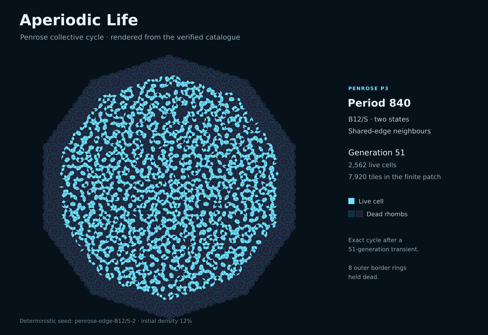

# Aperiodic Life

This package was vibe-coded by Murdoch J. Gabbay. I hope you find it useful and do not hesitate to submit patches if you find mistakes.

**Disclaimer:** This software is provided "as is", without warranty of any kind, express or implied, including correctness, reliability, merchantability, fitness for a particular purpose, or non-infringement. To the maximum extent permitted by applicable law, the authors and copyright holders accept no liability for any claim, loss, damage, or other liability arising from or in connection with the software or its use, including computer crashes, data loss, or damage to hardware or software, whether in contract, tort, or otherwise. Use it at your own risk. See [LICENSE](LICENSE).

Explore cellular automata on **square, hexagonal, Einstein-hat, and Penrose tilings**. Each tile is one cell. Change the rules, paint a seed, and watch patterns evolve on periodic and aperiodic boards.

Aperiodic Life 3.6.4 runs offline in a WebGL2-capable browser and includes **69 verified examples**. No installation or npm dependencies are needed to use it.



*The Penrose B12/S collective field at generation 51, rendered from the catalogue and its exact tile geometry.*

## Run it

Download or clone the repository, then open **[aperiodic-life-standalone.html](aperiodic-life-standalone.html)** in your browser. This single file includes the application, catalogue, styles, and licence notices.

To run the separate source files, start a local server from the repository directory:

```bash
python3 -m http.server 8000 --bind 127.0.0.1
```

Open [http://127.0.0.1:8000/index.html](http://127.0.0.1:8000/index.html). This also works when browser policy prevents opening local HTML files directly.

## Explore

- Search **Curated configurations** at the top of the controls by tiling, rule, or name. **Load** prepares an example paused; **Load & run** starts it immediately.
- Use **Play/Pause** at the top right of the canvas to start or stop the simulation. It stays accessible on mobile, including while the controls are open or scrolled.
- Try the Penrose period-822 oscillator, Einstein-hat rotating waves, compact Penrose travellers, or familiar square-grid gliders.
- For hexagonal highlights, search for **three-way spaceship gun**, **giant breather**, **self-repairing wall**, or **p4104**. The catalogue includes 28 hexagonal examples; the [hexagonal guide](docs/HEXAGONAL_STRUCTURES.md) explains their behaviour and evidence.
- Drag to pan; pinch with two fingers or use the wheel to zoom. Moving two fingers together pans, including with **Paint / erase cells** selected. Use a fresh one-finger tap or drag to paint.
- Use **Save state** and **Load state** to exchange exact experiments, including refractory cells and generation. **Copy settings** copies controls only.
- Open either **?** button for the rules, neighbourhoods, and finite-boundary explanation.

Rules use `B…/S…` notation, such as Conway's `B3/S23`. Additional cell states create refractory phases. Both shared-edge and edge-or-corner neighbourhoods are available.

## What the catalogue establishes

The catalogue includes exact localised oscillators, long transients, regular-lattice spaceships, and compact Penrose waves observed over stated finite intervals. Hexagonal examples include a period-4,104 clock, a period-999 rotor, a spaceship gun, an oscillator-trail puffer, a self-repairing wall, and a seven-copy replicator. The hexagonal search ran 6,630,400 deterministic seed trials, alongside a review and independent replay of published patterns. This is a bounded search, with no claim that the catalogue additions are previously unknown mathematical discoveries.

**The aperiodic travellers are finite-patch observations; no indefinitely propagating Penrose or Einstein-hat glider is claimed.** A translated return between two observed states does not establish that an aperiodic substrate repeats forever. Rotating waves are localised oscillators. Unsuccessful searches are bounded results, not nonexistence proofs.

See the [rule survey](docs/RULE_SURVEY.md), [research tools](research/README.md), [hexagonal phase atlas](research/figures/hexagonal-atlas.svg), and [aperiodic oscillator phase atlas](research/figures/oscillator-atlas.svg).

## Develop and contribute

Development uses **Node.js 22+** and **Python 3.10+**. Browser tests additionally require Chromium or a compatible executable. The application, build, standard tests, and research tools need no package-manager setup. Repeating the optional bulk hexagonal searches also requires a C++17 compiler.

```bash
node build-standalone.js
python3 tools/project.py test standard
python3 tools/project.py test topology
```

The first command regenerates the checked-in standalone file. See [CONTRIBUTING.md](CONTRIBUTING.md) for contribution and evidence requirements, and [testing](docs/TESTING.md) for browser, research, and large-patch profiles.

- [User and developer guide](docs/DEVELOPMENT.md): controls, geometry, and reproducible experiments.
- [Architecture](docs/ARCHITECTURE.md) and [core API](docs/CORE_API.md): implementation entry points.
- [Configuration and state files](docs/CONFIGURATION.md): settings and import formats.
- [Limitations](docs/LIMITATIONS.md) and [security and privacy](docs/SECURITY_AND_PRIVACY.md).
- [Publishing to GitHub](docs/PUBLISHING.md) and [release operations](docs/OPERATIONS.md).

## Licence

Project code is [MIT-licensed](LICENSE). The adapted Einstein-hat geometry retains Craig S. Kaplan's BSD 3-Clause licence; see [third-party notices](THIRD_PARTY_LICENSES.md). Keep both notices when redistributing the source or standalone application.
