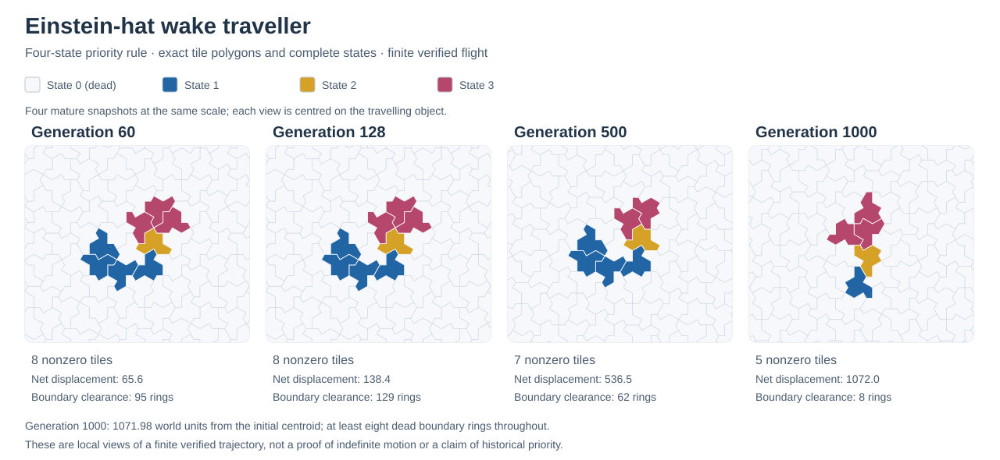

# Continued searches for travellers and launchers

This release includes reproducible results from a complementary search of
hexagonal, Penrose and Einstein-hat automata. Search programs, limits, seeds
and verification records are in [research/continued-search](../research/continued-search/README.md).
These are bounded computational experiments, not an exhaustive search of all
rules and configurations.

Eight newly curated examples accompany **8,034,400 additional bulk trials or
rule-and-seed evaluations**. Their verification and source credits are
separate from the search totals. Playback is set to four steps per second for
the new hexagonal examples and six for the new aperiodic examples.

| Campaign | Additional evaluations |
| --- | ---: |
| Hat priority tables | 1,440,000 |
| Hat B/S and Generations evolution | 1,000,000 |
| Hat alternating-background defects | 400,000 |
| Hat interacting seeds and emitting sources | 400,000 |
| Penrose launchers and high neighbour counts | 350,000 |
| Hexagonal mixed-state and larger seeds | 4,444,400 |

## An independently evolved Hat traveller

The strongest new result is a compact traveller under a four-state priority
rule, `TABLE:HAT-WAKE`. A random-table evolutionary lineage produced the
candidate; its seven-row table was reduced to four rows without changing any
of the 1,050 recorded complete states of the longest checked flight.

Use the edge-or-corner neighbourhood and states 0, 1, 2 and 3. Let `n0`, `n1`
and `n2` count neighbours in the corresponding state. Evaluate these rows in
order; the first match determines the next state:

| Current state | Condition | Next state |
| ---: | --- | ---: |
| 1 | `n0 >= 3` and `n2 >= 1` | 2 |
| 0 | `n0 >= 4` and `n2 >= 1` | 1 |
| 1 | `n0 >= 4` | 3 |
| 0 | `n1 >= 1` and `n2 >= 1` | 3 |
| Any | No previous row matched | 0 |

On a 372,100-tile depth-6 patch, the original six-cell seed has a verified
**1,000-generation interior flight over 1,071.98 world units**, with at most nine nonzero cells and
radius at most 4.638 world units. At generation 1,000 it has five nonzero
cells and retains eight boundary rings. The extended replay stops at the
boundary buffer at generation 1,049. Twelve checked placements of the seed
with congruent local surroundings all support long compact flights, although
their finite boundary horizons differ.

Independent direct-neighbour evolution reproduces saved complete states.
The return from generation 60 to 128 also matches labelled states, full tile
polygons, degree, adjacency and three surrounding dead rings under a
translation. The substrate beyond that finite neighbourhood is aperiodic:
this local return does **not** establish a fixed global period or perpetual
flight.

The mature recorded dynamics do not reproduce Edmond A, B, C, Spectre,
the package's derived SIMPLE rule or Goucher's Penrose table under any of the
341 checked nontrivial maps of nonzero states, including non-injective maps
that merge states or discard decoration. This is a comparison of realised
transitions, not a classification of every related rule. Removing the two
state-3-producing rows changes the trajectory but can still permit travel
from a suitable seed; the wake is not claimed to be essential to all travel.

James Edmond's [interactive project](https://offlattice.org/monotile/) and
[*Gliders on Aperiodic Monotilings: Cellular Automata on the Hat and Spectre*](https://arxiv.org/abs/2609.22579)
precede this work and supply important context: Hat gliders, corner-contact
neighbourhoods and priority-table searches are already published. The new
record establishes a package search lineage and a different tested rule
trajectory. **It does not establish the first Einstein glider, historical
priority for this rule, or indefinite propagation.**



The panels use the actual tile polygons and a common scale; they are centred
separately to show the changing anatomy. They do not depict a periodic global
environment.

## The two-row simplification is an adaptation

`TABLE:HAT-RELAY` uses three states and two rows: a state-1 cell with a
state-2 neighbour becomes 2; a state-0 cell with at least four state-0
neighbours and a state-2 neighbour becomes 1; everything else becomes 0.
Its tested mature flight is exactly reproduced by Edmond’s published Spectre
table under the state map `[0,1,2] -> [0,3,1]`. The rule has different guards
on other inputs, but this is an adaptation or transfer of a published
travelling mechanism, not a second independent glider discovery.

## An exactly certified hexagonal puffer

Under `B245/S02` with five states, the mixed seed
`[[0,1,2],[1,0,1],[2,0,1]]` launches two outward-moving puffer heads.
Coordinates are axial `(q,r,state)` triples. A puffer moves while depositing
debris, so the whole configuration is not a debris-free spaceship.

The isolated 28-cell head has an exact six-generation recurrence with
translation `(-2,4)` and leaves one stationary live cell per cycle.
The certificate checks complete labelled states, the stationary deposit,
and separation of the dependency neighbourhoods over all intervening phases.
Translation invariance of the infinite hexagonal lattice then supports
unbounded continuation of the certified isolated puffer. This is stronger
than observing a finite animation.

An earlier package search had retained an unresolved four-live-cell seed
under this rule. The new three-cell mixed seed led to recognising and
certifying the mechanism. Therefore this is a newly verified and catalogued
package find, not a claim that the rule or behaviour had never been seen.
No earlier exact-pattern source was established by the available indexed
searches; this limited negative result does not establish originality.

The third hexagonal example is a `B2345/S24`, four-state spaceship with exact
minimal period 48 and displacement `(-32,16)`. Seven live cells launch it
after a 16-generation transient; the catalogue starts from a centred
recurrent phase. Eighteen phases admit a spatial partition, but every extra
piece dies within four generations while one persistent body recreates the
orbit. This check supports a spaceship with transient sparks, rather than a
convoy. Birth at five is inactive in the orbit, whose effective rule is
`B234/S24`; the original search rule is retained. Its historical priority is
unestablished. A different period-130 candidate decomposed into two smaller
ships and was not promoted as a new coherent spaceship.

## Interacting launchers and a recurring Hat source

Under Edmond's published Hat A rule, a connected six-cell seed launches six
separated travellers. Their independent evolutions reconstruct every full
state from generation 60 to 180. Each has a complete-state, polygon and
radius-three dead-neighbourhood translated return in that interval. Every nontrivial partition of the initial
seed into two independent parts diverges from the actual interacting launch;
no smaller subset reaches the same checked result. This is a finite launcher
of known Hat A gliders, not a new glider rule or repeating gun.

A three-cell seed under Edmond's unchanged Hat B rule ignites a recurring
source. Its entire state at generation 30 is a 56-cell source obeying a complete
40-step identity: its next state is exactly the original source plus an
23-cell emitted packet containing four compact travellers. Each has at most
seven active cells and is independently replayed through 140 steps. Two
pairs follow the same complete trajectories 20 steps apart. At every source
generation through 180, independent emitted cohorts reconstruct the whole
evolution, with at least seven boundary rings. Independent evolution tests distinguish this from a crop
that merely looks periodic or is fed by returning activity. The original
seed is replayed through generation 180 with ten boundary rings remaining.
The accompanying verifier records the precise source and packet intervals.
This is a **recurring emitter with finite verification**, a candidate glider
gun; perpetual emission and historical priority remain unestablished. The
40-step identity is not asserted to be a least source period.

The Penrose addition uses `B2/S` with six states. Three live cells launch
twelve compact travellers on the depth-10 sun patch. Independent packet
evolutions reconstruct every whole state from generation 90 to 130, retaining
seven boundary rings. All twelve have complete-state/polygon translated
returns; five also have matching radius-three surroundings within that
interval. The three-cell seed has no proper subset with the same checked
endpoint. Larger placements with matching initial surroundings can give
different later outcomes, so this is a specifically located finite launcher
in the established B2/S propagation family.

## What negative results mean

Ordinary B/S and Generations searches on both Hat graphs still did not
establish a persistent compact glider. A promising directional prefix
eventually spread, while a long compact survivor ultimately became a
stationary oscillator. A separate 400,000-trial B0 experiment searched finite
defects on alternating uniform backgrounds; its independently replayed
record candidates died or settled into stationary cycles.

Small-seed and evolutionary searches have population, radius, time and
boundary cut-offs. They can miss large, slow, rare or long-transient
structures. Trial totals are workload measurements, not independent random
samples or statistical confidence levels. Apparent motion, local periodicity
and a changing number of connected components are screening signals, not
glider or gun certificates.

## Release verification

All standard checks pass, including the catalogue's 89 configurations, exact
credits, source/standalone consistency, interaction tests and deterministic
archive export. The eight new entries are tied to their scientific fixtures.
The original 81 entries retain every setting, seed, speed and credit.
The independent larger-patch Hat replay and polygon/topology checks also
pass. Browser automation and fresh on-device mobile testing were not run in
this search round; the established automated gesture and viewport tests pass.

```sh
python3 tools/project.py test standard
node research/continued-search/verification/verify.js --long
```
