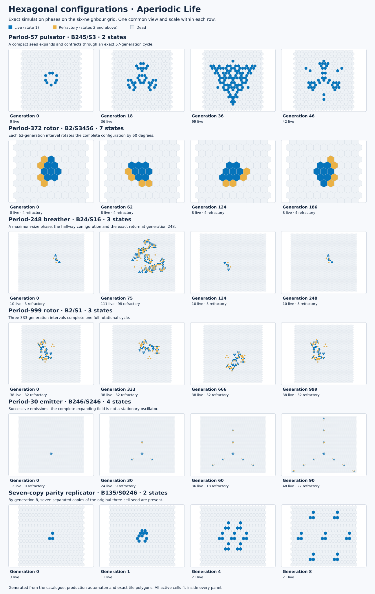

# Hexagonal structures

The hexagonal catalogue contains 28 configurations, including compact clocks, rotating waves, expanding and contracting oscillators, spaceships, a replicator, a gun, a puffer and a repairing wall. Open **Curated configurations**, search for a rule or period, and choose **Load and run**. **Play/Pause** remains available above the canvas on a phone as well as a desktop.

Every example uses the regular honeycomb and its six adjacent cells. These examples illustrate several different rules; they do not all run under `B3/S23`. The configuration loads the appropriate rule, state count, speed and view automatically. In the tables below, `C` is the total number of states, including dead state 0. Only live state 1 contributes to neighbour counts. States 2 to `C−1` are refractory.

## Suggested starting points

| Configuration | Rule | C | What to watch |
| --- | --- | ---: | --- |
| Period-372 rotor | `B2/S3456` | 7 | A compact wave turns through 60 degrees every 62 generations; six turns restore the complete labelled state. |
| Period-248 breather | `B24/S16` | 3 | The active population expands from 13 to 209 cells and contracts again. Its exact return takes 248 generations. |
| Period-4,104 oscillator | `B234/S3` | 2 | A small bounded structure has a surprisingly long exact cycle. Increase the playback speed to see a complete return. |
| Period-269 oscillator | `B34/S234` | 2 | A compact, irregularly changing oscillator with a long exact period. |
| Period-23 spaceship | `B234/S13` | 4 | The complete pattern, including its refractory wake, moves by axial displacement `(10, −5)` every 23 generations. |
| Period-25 spaceship | `B245/S35` | 2 | A binary traveller with diagonal displacement `(1, 1)` every 25 generations. |
| Seven-copy replicator | `B135/S0246` | 2 | Three starting cells produce seven separated copies at generation 8: one central copy and six surrounding copies. |
| Period-30 gun | `B246/S246` | 4 | A stationary source emits three period-3 spaceships every 30 generations, in three directions. |
| Period-20 puffer | `B25/S34` | 2 | A moving source leaves period-2 debris behind. Its source advances `(0, 10)` in 20 generations. |
| Repairing wall | `B2/S34` | 2 | Damage to a long wall heals into a period-5 cycle after 44 generations. |

The catalogue also includes small `B3/S23` oscillators of periods 2, 3, 4, 5, 6 and 8; `B2/S34` period 48; `B245/S3` period 57; and `B24/S3` period 128. The period-57 pattern grows from 9 to 99 live cells during its cycle. The period-48 and period-128 patterns have exact half-turn phase relations halfway through their full cycles.

For longer excursions, try the five-state `B23/S13` period-138 spaceship, the three-state `B2/S1` period-158 spaceship, the three-state `B2/S1` period-999 rotor, or Dean Hickerson's `B2/S34` period-2,044 billiard-table oscillator. John Cerkan's binary `B23/S4` period-13 spaceship supplies another compact example of diagonal travel.

Each row uses one fixed frame, so changes in extent are visible. Regenerate the figure with `node research/render-hexagonal-atlas.js` from the repository root.

## What the verification establishes

An **exact oscillator period** is the least positive generation at which every cell returns to its original state. This includes refractory cells. Equal population counts, matching bounding boxes or a visually similar frame do not establish a period. Selected long-period oscillators are also checked at individual sites: a long period is not accepted merely because several independent shorter clocks have that least common multiple.

An **exact spaceship** returns to the complete original configuration translated by a nonzero vector. The hexagonal lattice has global translation symmetry. An independently verified translated return, clear of boundaries, therefore establishes repeated motion on the unbounded lattice. The browser still displays a finite patch: a ship can eventually reach its edge.

Axial coordinates use neighbour offsets `(1, 0)`, `(0, 1)`, `(−1, 1)`, `(−1, 0)`, `(0, −1)` and `(1, −1)`. A displacement `(q, r)` spans `max(|q|, |r|, |q+r|)` neighbour steps. This makes speeds in different directions comparable without confusing axial coordinates with perpendicular screen axes.

A **rotation phase relation** compares every cell and its state after a specified rotation about a fixed centre. It is stronger than observing a turning bright front. For example, the seven-state rotor has a full period of 372 even though its population sequence repeats after 62 generations.

The **gun and puffer have certificates of indefinitely repeated emission on the unbounded lattice**. The gun restores its source after 30 generations and adds three exact period-3 spaceships. The puffer restores its translated source after 20 generations and leaves a period-2 deposit. For every phase, integer projections of the occupied cells establish permanent separation between the source, successive emissions and different streams. The minimum certified gaps are 7 for the gun and 3 for the puffer; a gap of at least 3 keeps their radius-one dependency neighbourhoods disjoint. Repeating the verified source cycle therefore cannot be disrupted by earlier emissions. Two independent implementations check these claims.

The whole emitted configuration grows, so these source periods do not make the entire pattern an oscillator or a finite spaceship. The browser uses a finite patch and will eventually encounter its boundary. Longer finite replays check practical display behaviour; the separation certificates supply the additional argument for unbounded continued emission.

The **replicator** has an additional algebraic explanation. `B135/S0246` computes the exclusive-or of a cell and its six neighbours. Over binary arithmetic, advancing by `2^k` generations gives the exclusive-or of seven copies of the initial pattern, translated by `2^k` times the six neighbour vectors and by zero. For the supplied three-cell seed these copies are disjoint at generations 8, 16 and 32, giving exactly 21 live cells at each of those times. Intermediate generations can contain many more cells. This describes replication on the unbounded lattice; a finite browser patch eventually limits its growth.

## Search and provenance

The examples combine deterministic computational searches, independent coordinate-based replay, and patterns retrieved from their authors' public posts. Candidate selection compares cycle phases under all twelve rotations and reflections of the hexagonal lattice, and checks the complete states against the application's simulation engine. Rule clauses unused by a selected recurring orbit are removed where the reduced rule reproduces that entire orbit.

The computational work completed **6,630,400 seed trials** across complementary binary, refractory-state and oscillator searches, and added 21 hexagonal examples to the catalogue. It samples finite soups and rules under explicit generation, population and boundary limits. It is a substantial search, not an exhaustive classification. A failed trial or an empty result for a rule does not prove that interesting patterns cannot exist. No mathematical priority claim is made for the computationally found examples.

The [reproduction guide](../research/hex-search/README.md) provides the search programs, deterministic seeds, completed campaign counts and stopping conditions. The [research guide](../research/README.md) explains catalogue verification. Preserve the source attributions when reusing published configurations:

- **c0b0p0** posted the three-state `B2/S1` period-999 oscillator and period-158 spaceship in the [hexagonal Generations discussion](https://conwaylife.com/forums/viewtopic.php?f=11&t=1319).
- **confocaloid** posted the four-state `B246/S246` period-30 gun in the [same discussion](https://conwaylife.com/forums/viewtopic.php?f=11&t=1319).
- **Naszvadi** posted the binary `B25/S34` puffer in [this post](https://conwaylife.com/forums/viewtopic.php?p=177053#p177053); the thread also points to an [earlier occurrence](https://conwaylife.com/forums/viewtopic.php?p=163227#p163227).
- **Dean Hickerson** supplied the repairing wall and billiard-table examples in the [hexagonal-rule discussion](https://conwaylife.com/forums/viewtopic.php?p=28428).
- **John Cerkan** supplied the `B23/S4` period-13 spaceship in the [hexagonal-rule discussion](https://conwaylife.com/forums/viewtopic.php?f=11&t=3670).
- The computational survey recovered one of the `B2/S34` period-48 oscillators shown in **drc**'s published two-pattern example in the [hexagonal-rule discussion](https://conwaylife.com/forums/viewtopic.php?p=28428). Its inclusion does not imply a new discovery.

See [third-party attribution](../THIRD_PARTY_LICENSES.md) for the existing Golly/Carter Bays spaceship and the published pattern sources.

## Small-seed launchers and knightships

Five further examples come from the exhaustive connected-seed scan: a three-cell `B2/S0` three-state glider (period 2), a four-cell diagonal launcher (period 8), a five-cell launcher (period 43), and six-cell knightship launchers (periods 9 and 10). A knightship moves between standard hexagonal axes and diagonals. All five have complete-state translated recurrence in an independent unbounded simulator. The period-10 launcher uses `S5` during ignition but not in its recurring orbit. See [the intensive search report](GLIDER_SEARCH.md) for exact rules, transients, displacements and scope, and run `node test-hex-exhaustive-evidence.js` to reproduce their certificates. The catalogue contains 33 hexagonal configurations.
