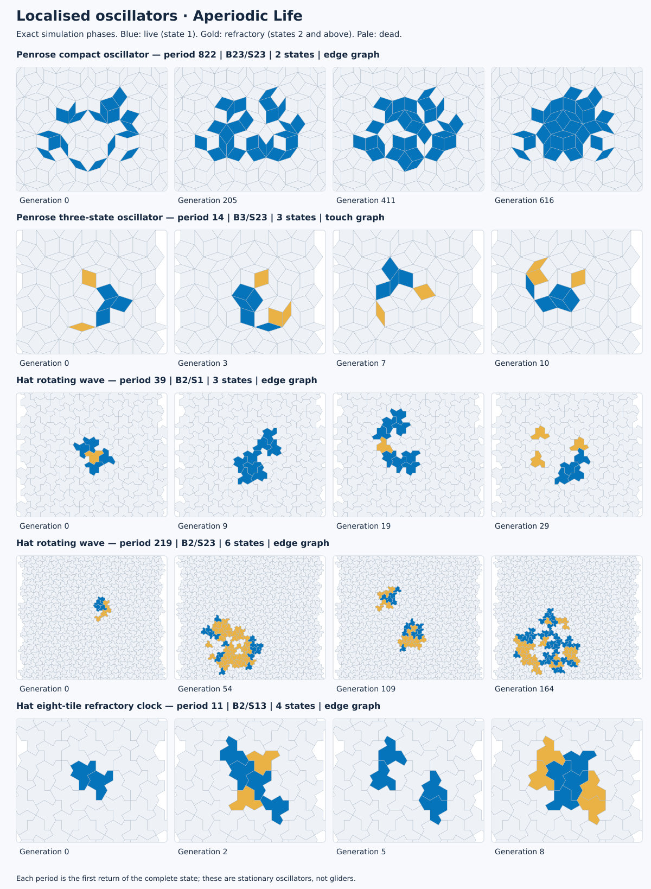

# Catalogue rules and structures

The curated configurations in `discoveries.js` use each tile as one cell. B/S rules count state-1 neighbours, with optional refractory states; named priority tables count neighbours in each state separately. Neither family reads tile orientation or hierarchy. Geometry and the selected contact graph supply the local structure. The [configuration reference](CONFIGURATION.md) defines both transition models.

## Einstein-hat travellers and launchers

The hat catalogue includes James Edmond's published priority-table rules, credited adaptations, and a four-state wake rule obtained from a random-table search lineage. They use the existing hat touch graph. The listed horizons are complete-state replays on this project's independently generated geometry, with boundary clearance throughout.

| Configuration | Named rule | States | Verified generations |
| --- | --- | ---: | ---: |
| Hat A single traveller | `TABLE:HAT-A` | 4 | 307 |
| Hat B single traveller | `TABLE:HAT-B` | 4 | 307 |
| Hat C single traveller | `TABLE:HAT-C` | 4 | 311 |
| Three-state hat relay | `TABLE:HAT-SIMPLE` | 3 | 307 |
| Hat C triple launcher | `TABLE:HAT-C` | 4 | 160 |
| Hat A six-packet launcher | `TABLE:HAT-A` | 4 | 180 |
| Hat wake traveller | `TABLE:HAT-WAKE` | 4 | 293 |
| Two-row relay, Spectre adaptation | `TABLE:HAT-RELAY` | 3 | 235 |

These are finite demonstrations, not proofs of unlimited flight. The triple launcher emits separate moving objects; it is not a periodically emitting gun. The six-packet Hat A launch is also a finite emission event under a published rule. A launch and a settled single traveller are different catalogue behaviours under the same rule. The Hat B periodic-emitter candidate restores its extracted source after 40 generations while adding an emitted state; the checked finite separations do not establish an indefinitely operating gun.

Edmond's [18 September 2026 preprint](https://arxiv.org/abs/2609.22579) reports hat and Spectre patterns followed for one million graph-distance rings, while explicitly leaving indefinite propagation unproved. His published Hat A/B/C and Spectre rules precede their package reproductions and adaptations. The derived SIMPLE rule relabels Hat B's state 3 as 2 and removes its empty-neighbour condition. It matches the checked flights but differs on arbitrary states; no priority claim is made for that simplification. See [rule sources](../research/fixtures/published-priority-rules.json) and [attribution](../THIRD_PARTY_LICENSES.md).

The wake traveller's six-cell launch also has a depth-6 replay through generation 1,049; that longer result belongs to the recorded six-cell seed. Its mature transitions differ from the included published tables under the checked state maps. This establishes a distinction within that comparison, not worldwide priority or indefinite propagation. The two-row relay instead reproduces Edmond's Spectre mechanism over its checked mature flight after relabelling states; it is credited as an adaptation. The [continued-search report](CONTINUED_SEARCH.md) gives the rules, comparison limits and launcher/emitter results.

## Exact localised oscillators

The [individual catalogue credits](CATALOGUE_CREDITS.md) distinguish earlier publications from package search results. The binary Penrose period-12 example has the same period, cycle territory and minimum population as Owens and Stepney’s published “fireworks” oscillator. Its exact identity remains unverified; those statistics alone do not establish a match. The earlier work is credited as a possible antecedent. Package search records alone do not establish historical priority.

A period is the first return of the complete labelled state, including all refractory cells. Cycle territory counts every tile used during a period rather than the simultaneous population.

| Pattern | Rule and graph | States | Period | Cycle territory |
| --- | --- | ---: | ---: | ---: |
| Penrose compact oscillator | `B23/S23`, edge | 2 | 822 | 46 tiles |
| Penrose three-state oscillator | `B3/S23`, touch | 3 | 14 | 27 tiles |
| Hat small rotating wave | `B2/S1`, edge | 3 | 39 | 39 tiles |
| Hat large rotating wave | `B2/S23`, edge | 6 | 219 | 300 tiles |
| Hat refractory clock | `B2/S13`, edge | 4 | 11 | 8 tiles |

In the period-822 oscillator, 39 of the 46 tiles have least temporal period 822 individually. The long period is therefore not merely the least common multiple of independent shorter clocks. The supplied depth-8 pattern is well clear of the finite boundary.

The hat waves have a local 120-degree clockwise phase relation after 13 and 73 generations respectively. Their complete labelled states recur after three such intervals. This is a property of the pattern's occupied territory, not a claim that the whole surrounding tiling has rotational symmetry. Their instantaneous nonzero support can split.

The eight-tile clock starts with two live tiles. With the same phase and total state count `C`, its period is `2C + 3` for each computationally checked `C = 4…255`. The browser supports counts up to 32; the core API supports the larger counts. No claim is made beyond the checked range.



The catalogue also includes binary Penrose touch-graph `B3/S23` oscillators of periods 4, 5, 7, and 12, a Penrose edge-graph period-4 example, hat touch-graph `B3/S23` periods 6, 9, and 26, a hat edge-graph period-15 example, a hat `B2/S` period-8 oscillator, and hat `B23/S` periods 20, 24, and 28.

## Finite Penrose travellers

The touch-graph `B2/S` family has a live front followed by refractory cells. Four-, five-, and six-state catalogue phases remain compact and connected through generation 220. Exact complete-state translated phases also match the surrounding contact graph through radius 3.

| Rule | States | Supplied support | Verified horizon | Characteristic launch behaviour |
| --- | ---: | --- | ---: | --- |
| `B2/S` | 4, 5, or 6 | Explicit complete phases | 220 | Compact live-front/refractory-wake motion |
| `B24/S` | 4 | 27 live cells | 200 | Eight births require the `B4` clause |
| `B2/S4` | 5 | 7 live cells | 200 | Two four-neighbour survivals |
| `B26/S` | 4 | 18 nonzero cells, including 8 live | 200 | One six-neighbour birth |
| `B27/S4` | 4 | 26 live cells | 200 | Four seven-neighbour births and seven four-neighbour survivals |
| `B2/S` | 5 | Five-traveller launcher, depth 11 | 240 | Multiple separate compact travellers |
| `B2/S` | 6 | Six-traveller launcher, depth 11 | 200 | Multiple separate compact travellers |
| `B2/S` | 6 | Three live cells, depth 10 | 130 | Twelve independently evolving compact travellers after generation 90 |

The launchers demonstrate different transients into related compact motion. Catalogue contracts check the distinguishing events, boundary clearance, trajectory bounds, translated phases, and complete final states. For the twelve-traveller launcher, all twelve bodies have complete-state/polygon translated returns, while five also have a radius-3 neighbourhood match within generations 90–130. Independently evolving the twelve bodies reproduces the entire labelled state at every generation of that interval. This is an additional launcher for the existing B2/S family, not a new recurring mechanism.

**All catalogue Penrose travel claims are finite.** A radius-3 graph match at two phases does not give a global translation symmetry. The continuation may encounter a different environment. These results do not establish an indefinitely propagating B/S glider, a gun, a stable collision system, or computation on the tiling. Goucher's different multistate rule has a published geometric propagation argument, discussed below.

## Regular hexagonal spaceships

The hexagonal catalogue includes exact spaceships, oscillators, rotors, a gun, puffers, wall repair, a billiard table and a parity replicator. The [hexagonal guide](HEXAGONAL_STRUCTURES.md) introduces the main behaviours. The table below records selected traveller benchmarks; the catalogue and research fixtures supply the complete current selection and verification records.

The regular hexagonal lattice is translation invariant. Exact complete-state recurrence under a nonzero axial translation therefore establishes indefinitely repeated motion on the unbounded lattice when the observed evolution is independent of the finite boundary.

| Rule | States | Exact translated return | Axial displacement |
| --- | ---: | --- | --- |
| `B2/S35` | 2 | Generation 0 to 5 | `(1, 0)` |
| `B245/S3` | 2 | Generation 0 to 10 | `(2, 0)` |
| `B235/S146` | 4 | Generation 21 to 31 | `(-5, 0)` |
| `B235/S134` | 5 | Generation 58 to 62 | `(2, 0)` |
| `B2345/S24` | 4 | Recurrent phase 0 to 48 | `(-32, 16)` |

The binary `B245/S3` phase comes from Golly's hexagonal-rule example and corresponds to Carter Bays's period-10, displacement-2 ship in survival/birth notation `3/2,4,5`. The nine-cell supplied phase has population sequence `9, 13, 17, 18, 16, 17, 15, 16, 15, 11, 9`. See the [pattern source record](../research/fixtures/hex-b245s3-source.json) and [third-party attribution](../THIRD_PARTY_LICENSES.md).

The `B235/S146` and `B235/S134` examples share a 12-live-cell seed geometry but have different launches and recurring orbits. `B235/S146` reaches a period-10 orbit using only `B23/S1`; `B5`, `S4`, and `S6` are launch-only clauses. `B235/S134` reaches a period-4 orbit using `B23/S134`, with `B5` active only during launch. A launch rule is not the same thing as the effective recurring rule.

The four-state period-48 `B2345/S24` ship has one persistent moving body with short-lived sparks. Its recurrent orbit uses only `B234/S24`; `B5` is inactive during that orbit. A seven-live-cell seed reaches the orbit after 16 generations.

The five-state `B245/S02` puffer advances by axial `(-2, 4)` every six generations and deposits one stationary live cell per cycle. A three-cell mixed-state launch produces two opposite copies plus four stationary cells by generation 30. Exact separation certificates establish unbounded continuation on the regular lattice; the browser board remains finite. The `B5` clause fires twice during ignition and is unused in the recurring heads. See the [continued-search report](CONTINUED_SEARCH.md) and [hexagonal guide](HEXAGONAL_STRUCTURES.md).

Hexagonal `B3/S23` oscillators of periods 2, 3, and 6 provide further small calibration cases. Both contact-graph choices coincide on the regular honeycomb.

## Transients and collective behaviour

The ten-cell hat `B2/S1`, ten-state directional transient uses the touch graph. Its last live cell disappears at generation 75 and its entire refractory wake at generation 83. It is not a glider and is not connected throughout.

The Penrose `B3/S23` catalogue includes extinction at generation 293 and a transient of 289 generations before a fixed point. The Penrose `B12/S` collective field has transient 51 and exact period 840. This is a distributed field rather than a compact local oscillator.

The three-state Penrose `B2/S` excitable field and binary hat `B1/S` wave field remain active through their stated 3,000-generation observation windows. They may later cycle, freeze, die, or reach the finite boundary.

Classic square examples supply familiar reference behaviour: block, blinker, pulsar, pentadecathlon, glider, lightweight spaceship, HighLife replicator, Diehard, R-pentomino, and Acorn. The final two are finite-board runs with explicit observation horizons, not claims about infinite-plane asymptotics.

## Reproduction and interpretation

Run from the repository root:

```bash
node research/verify-catalog.js
node test-structures.js
node test-traveller-evidence.js
python3 tools/project.py test research
```

The catalogue verifier reconstructs every configuration and checks its declared contract. Independent tests compare complete states and local graph translations. Exact periods are never inferred from population alone. See [testing](TESTING.md) and the [research guide](../research/README.md) for search commands and current fixtures.

Search output is evidence for its recorded configurations and horizons. Coarse duplicate-suppression fingerprints are not counts of distinct structures; unsuccessful bounded searches do not prove nonexistence. No literature-priority claim is made for the catalogue's aperiodic structures.

## Related mathematical work

Goucher's four-state Penrose rule is uniform and semi-totalistic: it reads neighbour-state counts, not ribbon labels or tile orientations. De Bruijn ribbons enter its geometric proof: on P3 rhombs, entering one edge and leaving the opposite parallel edge gives monotone progress. On kite-and-dart tilings related paths can close. Its printed table's second row must produce state 1 rather than 3 to agree with the adjoining prose; the corrected rule is available programmatically as `TABLE:PENROSE-GOUCHER`.

The Bailey–Lindsey construction uses additional local tiling structure to obtain an automaton isomorphic to ordinary Life. It is a different construction from Goucher's rule and from the catalogue's B/S travellers. Aperiodicity alone does not prohibit gliders or universal computation.

- N. Owens and S. Stepney, *Investigations of Game of Life Cellular Automata Rules on Penrose Tilings: Lifetime, Ash, and Oscillator Statistics*, Journal of Cellular Automata 5(3), 2010, 207–225, [author's copy](https://www-users.york.ac.uk/~ss44/bib/ss/nonstd/jca10.pdf).
- A. P. Goucher, *Gliders in Cellular Automata on Penrose Tilings*, Journal of Cellular Automata 7(5–6), 2012, 385–392, [author's copy](https://cp4space.hatsya.com/wp-content/uploads/2012/11/2012-penrose-gliders.pdf).
- D. A. Bailey and K. A. Lindsey, *A Game of Life on Penrose tilings*, [arXiv:1708.09301](https://arxiv.org/abs/1708.09301).
- K. Imai, T. Hatsuda, V. Poupet, and K. Sato, *A Universal Semi-totalistic Cellular Automaton on Kite and Dart Penrose Tilings*, [arXiv:1208.2771](https://arxiv.org/abs/1208.2771).
- J. Edmond, *Gliders on Aperiodic Monotilings: Cellular Automata on the Hat and Spectre*, [arXiv:2609.22579](https://arxiv.org/abs/2609.22579).
- Carter Bays, *A Note on the Game of Life in Hexagonal and Pentagonal Tessellations*, [Complex Systems 15(3)](https://www.complex-systems.com/abstracts/v15_i03_a04/).
